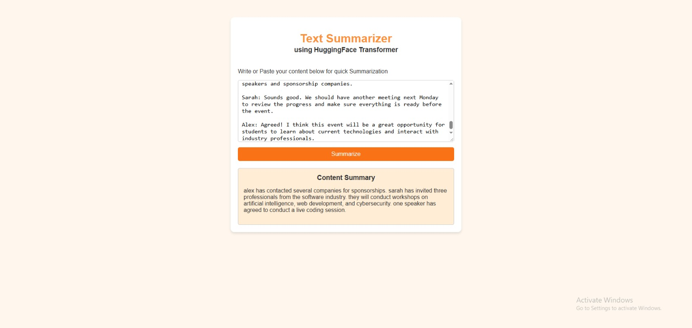

# 🤖 AI Text Summarization System

An interactive **AI-powered Text Summarization Web Application** that generates concise summaries from lengthy text and conversations using a fine-tuned **T5-small Transformer Model**.

---

## 🌐 Live Demo

🚀 **Web Application:** https://text-summarizer-app-n97a.onrender.com/

🤗 **Hugging Face Model Space:** https://huggingface.co/spaces/HITESHCODER/text-summarizer-app

---

## 💻 GitHub Repository

https://github.com/Hitesh-77/TEXT-SUMMARIZER-APP

---

## 📸 Screenshots

### Text Summarization



---

## ✨ Features

- 🤖 AI-powered text summarization
- 🧠 Fine-tuned T5-small Transformer Model
- 📝 Summarizes lengthy text and conversations
- ⚡ Fast summary generation
- 🌐 Interactive web-based interface
- 📋 Simple text input and summary output
- 🔗 Backend integration with Hugging Face Spaces
- 🚀 REST API for summarization
- 🎨 Custom HTML and CSS-based interface
- 🔄 Real-time communication between frontend and backend

---

## 🧠 Machine Learning Pipeline

The application uses a fine-tuned **T5-small (Text-to-Text Transfer Transformer)** model for abstractive text summarization.

### Model Training

- Pre-trained T5-small Transformer
- Fine-tuning on a summarization dataset
- Tokenization and text preprocessing
- Training and validation
- Model evaluation
- Saving the fine-tuned model

### Model Architecture

- T5-small
- Encoder-Decoder Transformer Architecture
- Abstractive Text Summarization

### Input

- User-provided text or conversation

### Output

- AI-generated concise summary

---

## ⚙️ Application Architecture

The project uses a two-part deployment architecture.

### 1. Frontend & Backend

- **FastAPI** handles incoming requests.
- HTML, CSS and JavaScript provide the user interface.
- Jinja2 Templates render the web application.
- REST API handles summarization requests.

### 2. Model Hosting

- Fine-tuned T5-small model hosted on Hugging Face Spaces.
- Gradio provides the model inference interface.
- Gradio Client connects the FastAPI backend to the hosted model.
- Predictions are returned to the frontend through FastAPI.

---

## 🛠 Tech Stack

### Programming Language
- Python
- JavaScript

### Machine Learning & NLP
- PyTorch
- Hugging Face Transformers
- T5-small
- Tokenizers

### Backend
- FastAPI
- Pydantic
- Gradio Client
- Jinja2

### Frontend
- HTML
- CSS
- JavaScript

### Deployment
- Render
- Hugging Face Spaces

---

## 📂 Project Structure

```text
TEXT-SUMMARIZER-APP/
│
├── static/
│   ├── style.css
│   └── app.js
│
├── app.py
├── index.html
└── requirements.txt
```

**Note:** The fine-tuned T5-small model is hosted separately on Hugging Face Spaces. The FastAPI backend communicates with the hosted model using Gradio Client.

---

## 🚀 Installation

Clone the repository:

```bash
git clone https://github.com/Hitesh-77/TEXT-SUMMARIZER-APP.git
```

Move into the project directory:

```bash
cd TEXT-SUMMARIZER-APP
```

Install dependencies:

```bash
pip install -r requirements.txt
```

Run the FastAPI application:

```bash
uvicorn app:app --reload
```

Open your browser:

```text
http://127.0.0.1:8000
```

---

## 🔮 Future Improvements

- 📄 PDF and DOCX file summarization
- 📊 ROUGE-based model evaluation dashboard
- 🌍 Support for multiple languages
- 🎯 Adjustable summary length
- 📋 Summary history
- 📥 Download generated summaries
- ⚡ Streaming summary generation
- 🔍 Comparison between different Transformer models

---

## 👨‍💻 Author

**Hitesh Kumar**

BCA Student | AI & Machine Learning Enthusiast

GitHub:  
https://github.com/Hitesh-77

---

## ⭐ Support

If you found this project helpful, consider giving the repository a ⭐ on GitHub.